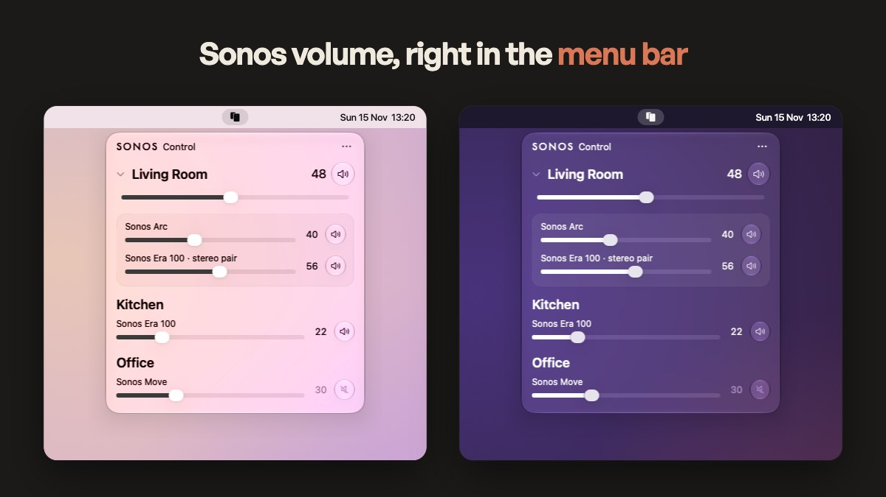
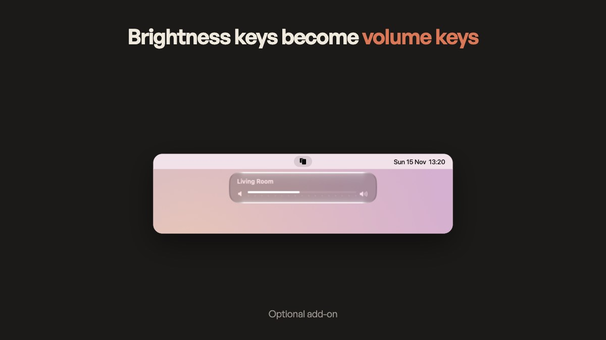

# Sonos Control

A menu bar volume control for Sonos speakers on macOS.



I wanted to change the volume of my speakers from my Mac without opening the Sonos app and waiting for it to load. Sonos Control sits in the menu bar and shows a slider and a mute button for each room.

I also wanted it to look like part of macOS rather than something added on top. The icon is an SF Symbol that macOS tints with the rest of the menu bar. The panel opens under it on the same native Liquid Glass as Control Center, and the sliders and buttons are the system's own, so they turn to glass while you drag them, just like the volume slider in Control Center. It follows light and dark mode, and it keeps out of the way until you click it.

It talks to the speakers directly over your local network. There's no account to sign in to and nothing is sent to the internet.

## What it does

- Finds your speakers on its own, usually in about a second.
- Shows a volume slider and mute button for every room.
- Picks up the groups you've made in the Sonos app and puts them at the top. A group gets one slider that keeps the speakers' levels relative to each other, as the Sonos app does, with the individual speakers underneath. You can fold the speakers away if you only use the group.
- Shows a stereo pair as one room.
- Lists every room. The panel grows to fit them all, and it only scrolls if it would run past the bottom of your screen (with no scroll bar).
- Works from the keyboard and with VoiceOver. A sideways two-finger swipe over a slider nudges the volume.
- Can open at login, from the menu under the "…" button.

It only reads from your speakers until you move a slider or press mute. Opening it never changes volume, grouping, source or playback.

## What it doesn't do

It's a volume control. It doesn't browse music, start or stop playback, change sources or edit groups. Use the Sonos app for those.

## Add-on: brightness keys as volume keys



If your Mac plays through a Sonos speaker over line-in, the Mac's own volume keys can't reach it. This add-on turns the brightness keys into Sonos volume keys, with feedback that looks like the indicator macOS shows for its own volume keys: a glass capsule drops from the menu bar icon with the room's name and level, and fades away a moment after the last press. You can drag it while it's showing.

It's niche, and it takes the brightness keys away from your screen, which you probably don't want on a MacBook. So it's left out of the normal build. To include it:

```sh
bash scripts/build-app.sh --brightness-keys install
```

Then switch it on under the "…" menu. It adjusts the room at the top of the panel. macOS will ask you to allow Sonos Control under Privacy & Security → Accessibility, because taking keys over from the system needs that permission. It listens for F1 and F2, the brightness keys on Apple keyboards, and F14 and F15 on older extended keyboards.

Each build is signed only for your own Mac, so macOS treats a rebuilt app as a new one. After rebuilding, remove Sonos Control from the Accessibility list with the minus button and switch the keys on again.

The code is all in `Sources/SonosControl/BrightnessKeys`.

## Requirements

macOS 26 Tahoe or later. I've built and tested it on macOS 27 on Apple silicon. It should run on macOS 26 and on Intel Macs, but I haven't tried either.

To build it you need Swift with the macOS 26 SDK or later, which comes with Xcode 26 or the matching Command Line Tools.

## Install

```sh
git clone https://github.com/bendrvry/sonos-control.git
cd sonos-control
bash scripts/build-app.sh install
```

That builds the app and copies it to `/Applications`. Leave off `install` to get it in `dist/` only.

Open Sonos Control and click the speaker icon in the menu bar. The first time, macOS asks for permission to find devices on your local network. Allow it, because that's how the app reaches the speakers.

The build is signed for your own machine only. It isn't notarized, so a copy sent to another Mac will be blocked by Gatekeeper until it's built there.

## If your speakers don't appear

- Check that the Mac and the speakers are on the same network.
- Check System Settings → Privacy & Security → Local Network, and make sure Sonos Control is switched on.
- Some routers block the broadcast that discovery relies on. Choose "Connect by IP Address…" from the menu and enter the address of any one speaker. You can find it in the Sonos app under About My System. One speaker is enough, since it reports the rest.

## How it works

Sonos speakers accept UPnP commands over HTTP on port 1400. The app finds them with an SSDP search, asks one speaker for the layout of the household, then reads and sets volume with the `RenderingControl` and `GroupRenderingControl` services.

While the panel is open it re-reads volume every 1.5 seconds, so changes made elsewhere show up. While the panel is closed it does nothing at all.

This UPnP interface isn't officially documented by Sonos. It has been stable for years and a lot of community software depends on it, but a firmware update could change it.

The panel, slider, buttons and glass come from `MenuBarKit.swift`, one file I share word for word between my menu bar apps so they all look and behave the same. [Awake Control](https://github.com/bendrvry/awake-control) uses it too. It's a plain status item and borderless panel on `NSGlassEffectView` rather than SwiftUI's `MenuBarExtra`, so the panel can sit on real Liquid Glass, grow downwards and draw its own soft shadow.

There are no dependencies.

| Path | What's in it |
| --- | --- |
| `Sources/SonosCore` | Discovery, SOAP requests, and the topology and volume models. No UI. |
| `Sources/SonosControl` | The menu bar app: the status item and panel, state and the slider. |
| `Sources/SonosControl/BrightnessKeys` | The brightness keys add-on and its volume indicator. |
| `Sources/SonosProbe` | A command-line tool that lists your speakers and their volumes. Read only. |
| `Tests/SonosCoreTests` | Checks for the parsing and request code, run against fixtures. |

The app only connects to private IPv4 addresses on port 1400, and it doesn't follow redirects.

## Development

```sh
swift run SonosChecks                  # fixture checks, no speakers needed
swift run SonosProbe                   # list speakers and volumes, changes nothing
bash scripts/build-app.sh
dist/SonosControl.app/Contents/MacOS/SonosControl --demo                # sample rooms, no network
dist/SonosControl.app/Contents/MacOS/SonosControl --demo --dark         # or --light
dist/SonosControl.app/Contents/MacOS/SonosControl --demo --demo-many    # enough rooms to need scrolling
```

With the add-on built in, `--demo --hud` shows the volume indicator every 3 seconds.

`--demo` opens the panel straight away with sample rooms and never talks to speakers. An app launched from Terminal isn't allowed to keep focus, so its panel closes straight away. Set `MENUBARKIT_KEEP_OPEN=1` to keep it open for screenshots.

Run the app from `dist` rather than with `swift run`. Swift Package Manager records the minimum macOS version as the SDK version, and AppKit then draws the older controls without Liquid Glass. The build script corrects that with `vtool`.

The checks are a plain executable instead of XCTest so they run with only the Command Line Tools installed.

## Credits

The protocol details come from the work of the [SoCo](https://github.com/SoCo/SoCo) project and Stephan van Rooij's [Sonos API documentation](https://sonos.svrooij.io).

Sonos is a trademark of Sonos, Inc. This project isn't affiliated with or endorsed by Sonos.

## License

[MIT](LICENSE)
